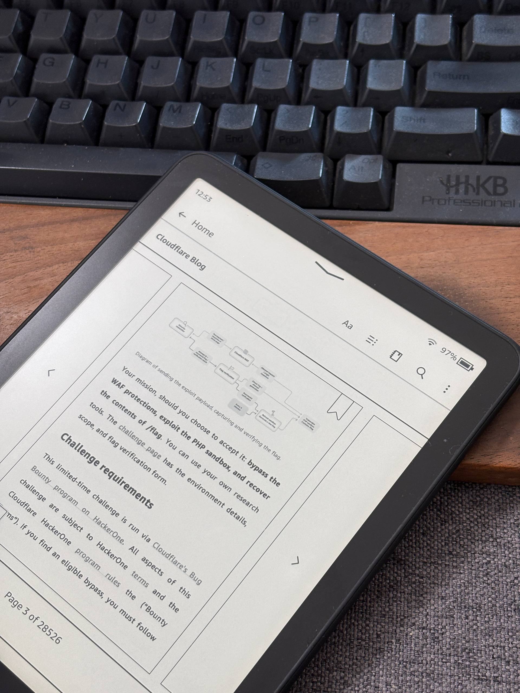
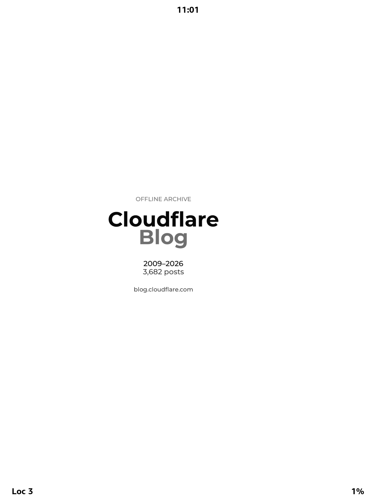
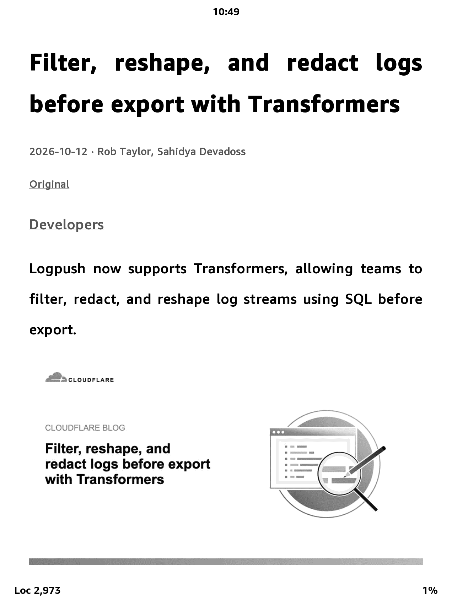
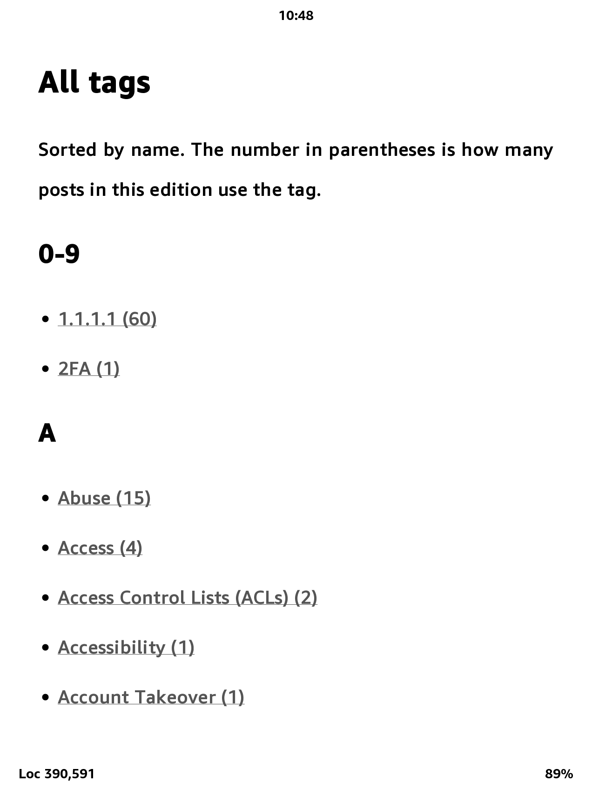
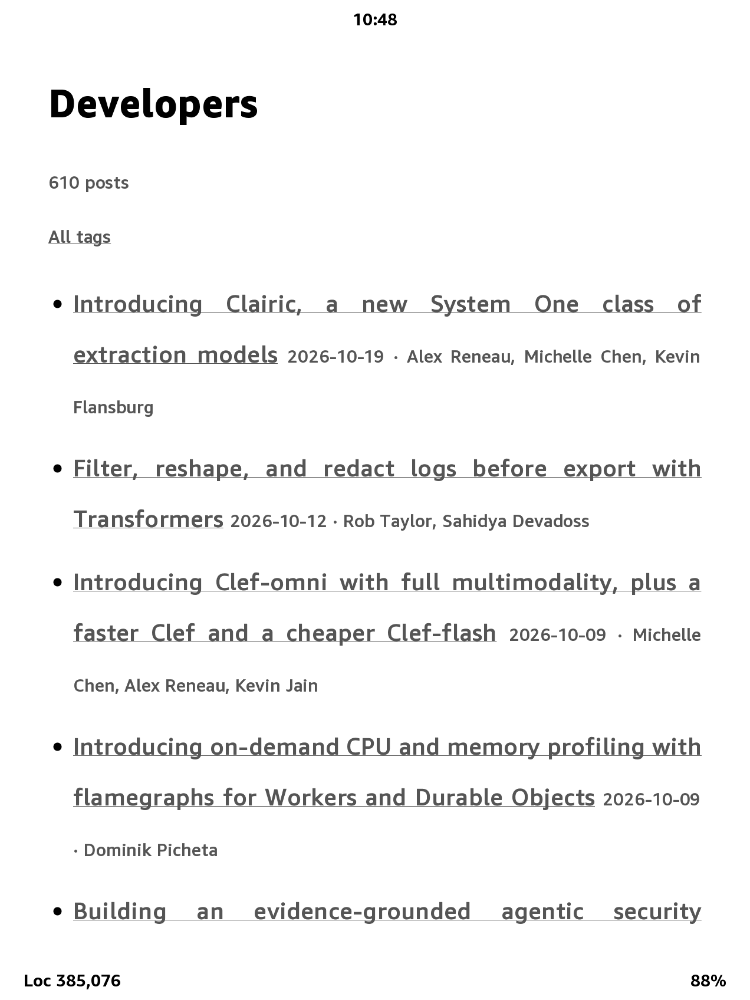
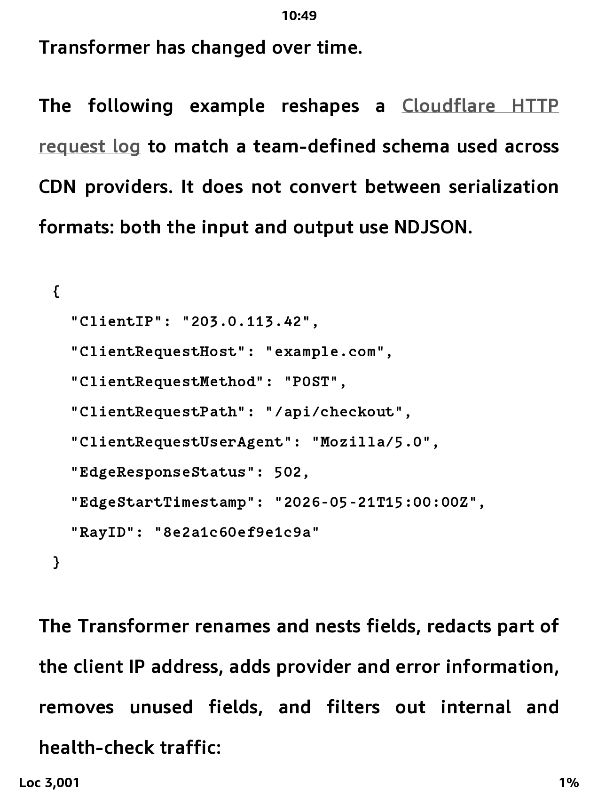

<p align="center">
  
  &nbsp;&nbsp;&nbsp;&nbsp;&nbsp;
  <picture>
    <source media="(prefers-color-scheme: dark)" srcset="docs/logos/epub-dark.svg" />
    
  </picture>
</p>

<h1 align="center">Cloudflare Blog EPUB</h1>

<p align="center">
  Build a personal offline EPUB of the English <a href="https://blog.cloudflare.com/">Cloudflare Blog</a>.<br>
</p>

## Screenshots

<p align="center">
  
</p>

On Kindle Paperwhite 4.

<p align="center">
  
  &nbsp;
  
  &nbsp;
  
</p>
<p align="center"><sub>Cover · Contents · All tags</sub></p>

<p align="center">
  
  &nbsp;
  
</p>
<p align="center"><sub>Chapter · Code block</sub></p>

Chapters run newest first, and each post appears once. A post that carries several tags is linked from each of those tag pages back to the same chapter.

## Install

Python 3.11 or newer, and network access to `blog.cloudflare.com`.

```bash
pip install -r requirements.txt
```

Dependencies: `httpx`, `beautifulsoup4`, `lxml`, `pillow`, `tqdm`.

## Usage

Run the commands from this repository. Cached files and the finished EPUB are written next to the scripts.

```bash
python sync.py
python build.py
```

`sync.py` reads the sitemap and, for each English post that is not already saved, downloads the HTML, parses it, writes JSON, and downloads the images in that post. Posts already on disk stay as they are when `lastmod` changes, unless you pass `--updated`. If their images are missing, the same run fills those in before fetching anything new.

`build.py` reads `data/` and does not use the network. It writes `cloudflare-blog-kindle.epub`.

A full archive is a few thousand posts plus images, so the first sync takes a while. Progress is printed for the sitemap, missing images, and posts. Run `python sync.py` again after an interrupt; finished posts are skipped.

Posts download four at a time, and images four at a time alongside them, so up to eight requests can run together:

```bash
python sync.py --concurrency 8
```

Keep the number modest. The site publishes a sitemap and allows crawling in [robots.txt](https://blog.cloudflare.com/robots.txt); the client retries `429` and `5xx`.

### Try a small book

```bash
python sync.py --limit 20
python build.py
```

`--limit` selects the N posts most recently updated in the sitemap. Until every English post is saved, tag pages count only downloaded posts, while the ten topic pages are still created. The cover states how many posts this edition includes and how many the site lists. After a complete sync, `python build.py` emits a page for every tag.

### Refresh changed posts

Sync does not overwrite a post that is already saved. Compare the local copy with the sitemap, then re-download the posts you care about:

```bash
python check.py
python sync.py --updated
python sync.py --slug origin-range-requests
```

`check.py` prints each saved post whose `lastmod` differs. `--updated` downloads those posts again, and still fetches posts that are not saved yet. Images already on disk stay cached. Passing `--slug` without `--limit` refreshes only those posts. Repeat `--slug` for more than one.

```bash
python sync.py --force
python sync.py --limit 20 --force
```

Build a subset of what is already downloaded:

```bash
python build.py --limit 50
python build.py --output /tmp/cloudflare-blog.epub
```

A relative `--output` is resolved from the directory that contains the scripts.

### Smaller images for Kindle

The default build embeds the images in `data/images`. A Kindle-oriented build writes a separate, smaller copy and leaves the originals alone:

```bash
python build.py --images kindle
python build.py --images kindle --image-edge 1000 --image-quality 60
```

`--image-edge` defaults to 1200 and only scales images down. `--image-quality` defaults to 70, in the range 1–95. Opaque images, and images with an alpha channel, are stored as JPEG with transparency flattened onto white. Animations keep their first frame. SVG files are copied unchanged. The cache lives at `data/images-kindle/e1200-q70/`; a different edge or quality uses a different directory. Without `--output`, this build writes `cloudflare-blog-kindle.epub`.

```
 python build.py --images kindle --image-edge 1000 --image-quality 60

read posts: 100%|█████████████████████████████████████████████████████████████████████| 3682/3682 [00:00<00:00, 35600.42post/s]
warning: 5 images are not on disk and will be skipped
compress: 100%|██████████████████████████████████████████████████████████████████| 16410/16410 [00:00<00:00, 917713715.20img/s]
copy images: 100%|███████████████████████████████████████████████████████████████████| 16410/16410 [00:00<00:00, 31378.26img/s]
tag pages: 100%|█████████████████████████████████████████████████████████████████████████| 782/782 [00:00<00:00, 4426.11page/s]
chapters: 100%|████████████████████████████████████████████████████████████████████████| 3682/3682 [00:01<00:00, 2198.31post/s]
pack:  64%|███████████████████████████████████████████████▍                          | 13399/20883 [00:04<00:02, 2991.41file/s]pack: 100%|██████████████████████████████████████████████████████████████████████████| 20883/20883 [00:06<00:00, 3235.66file/s]
wrote /home/path/to/cloudflare-blog-epub/cloudflare-blog-kindle.epub (508622478 bytes, 3682 posts, 782 tags)
```

AZW3 (Kindle Format 8) accepts JPEG, PNG, GIF, BMP, and SVG. It does not accept WebP or AVIF, and it does not keep animation or transparency. Copy the EPUB to the device with Calibre’s AZW3 conversion rather than embedding those formats here.

## Inside the book

Reading order:

1. Cover, with the edition size, copyright notice, and a link to the blog.
2. Posts, newest first.
3. Topics, including an **Outside these topics** list.
4. One page for each of those topics.
5. An alphabetical index of every tag.
6. One page for each remaining tag.

The reader contents list the cover, the ten topics, and **All tags**. Individual posts are not nested there. Topic names come from the site header and are read again on each sync. They are currently AI, Developers, Radar, Product News, Security, Policy & Legal, Zero Trust, Speed & Reliability, Life at Cloudflare, and Partners.

Each chapter keeps its date, authors, tags, and a link to the original URL. Links to other English posts in this edition point at the local chapter. Other links stay on the web. Downloaded images are limited to a 1400-pixel edge: PNG and GIF stay PNG, photographs are stored as JPEG.

Translations are skipped. A URL such as `/zh-cn/` or `/ja-jp/` is the same post in another language.

## Layout

| File         | Role                                               |
| ------------ | -------------------------------------------------- |
| `sync.py`    | Download pages, parse them, and cache images       |
| `check.py`   | List saved posts whose sitemap `lastmod` changed   |
| `build.py`   | Build XHTML, contents, and the EPUB offline        |
| `article.py` | Extract title, date, authors, tags, and body       |
| `fetch.py`   | HTTP with retries                                  |
| `images.py`  | Download, resize, and make the Kindle-sized copies |
| `epub.py`    | Pack the EPUB and check its structure              |
| `paths.py`   | Locations of `data/` and `build/`                  |

The parser is `article.py` because a module named `html.py` would shadow the standard-library `html` module.

## Cache

These paths are gitignored.

- `data/raw/{slug}.html` — fetched page
- `data/posts/{slug}.json` — parsed post
- `data/images/` — images saved during sync; build does not modify them
- `data/images-kindle/e1200-q70/` — JPEG copies for `--images kindle`
- `data/catalog.json` — English post list, topics, and tag names
- `data/image-manifest.json` — source filename to cached image
- `data/failures.json` — failures from the last sync
- `build/` — unpacked EPUB tree
- `cloudflare-blog.epub` — default book
- `cloudflare-blog-kindle.epub` — default Kindle-sized book

## Limitations

- English posts only as other languages blog posts are just translated posts.
- The full book, with images, is large.(~3 GB) Use `python build.py --limit` or `--images kindle` when a reader cannot open it. A Kindle still does best with smaller volumes; one file of several thousand chapters is heavy even after JPEG compression.
- Video and embedded pages become links to the original URL.
- Code blocks keep their text and drop the site’s highlighting scripts.

## AI involvement

Much of the coding work is done by AI.(Cursor Grok 4.7 High).

## License

The scripts and original documentation are [MIT](LICENSE). Blog posts, images, trademarks, and generated EPUBs are not. See [CONTENT-NOTICE.md](CONTENT-NOTICE.md).
